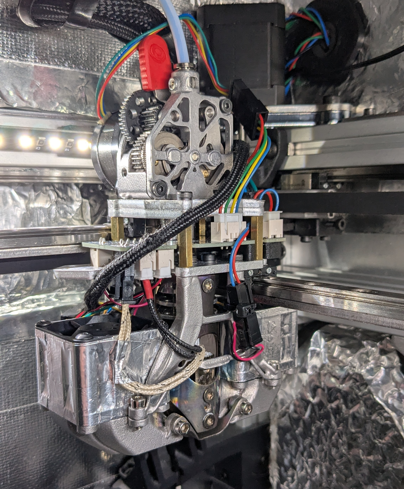

# Mathematical Potato's DooKi3 Toolhead V2 for Annex Engineering K3
Here lives an updated version of my DooKi3 Toolhead.  

This iteration allows for nearly full metal construction, optional flipping of the Y cross rail which allows any rail thicknesses to use the same Y spacers, new version of the K3rabiner, greater compatibility with extruders including DFA, and greater stiffness through the use of generatively designed and SLM printable bracing components.

## DooKi3_Upper Assembly:
The upper assembly is shared with both other versions.  It uses standoffs to bolt to the main X party plate.  A new version of the K3rabiner PCB can be mounting between the X and Y plates which allows for greater compatibility with more extruders, including DFA. The extra Y plate allows for an inverted Y rail configuration which provides the option for a one size fits all approach for Y spacers.  

## DooKi3 Lower SLM Generative Assembly (Recommended):
The SLM Generative version uses two braces that are designed to be SLM printed out of aluminum.  All SLM parts will need This version can be used with either SLM or FDM printed ducts. If you'd like to use rail backers, this version is not toolhead limited for size and allows for backers as large as you can fit in K3 travel.

This version of the lower allows the user to choose between the stock rail configuration where both X and Y cross rails mount to the X plate, or the inverted Y rail configuration where the X cross rail mounts to the X plate and the Y cross rail mounts to the Y plate.

## DooKi3 Lower Fan Plate and Standoffs Assembly (Cheaper):
The Fan Plate and Standoffs version uses 45mm standoffs and a lasercut plate to mount the fans.  This version is cheaper than the SLM option, but less stiff and less compatible.  You must use the inverted Y rail configuration with this setup and it is highly recommended to use the fan wings to increase stiffness which reduces the maximum size for backers.

