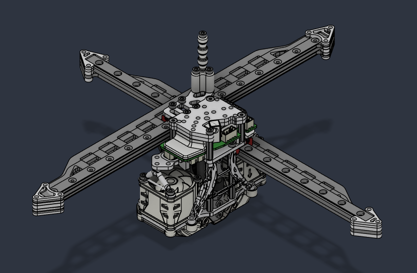
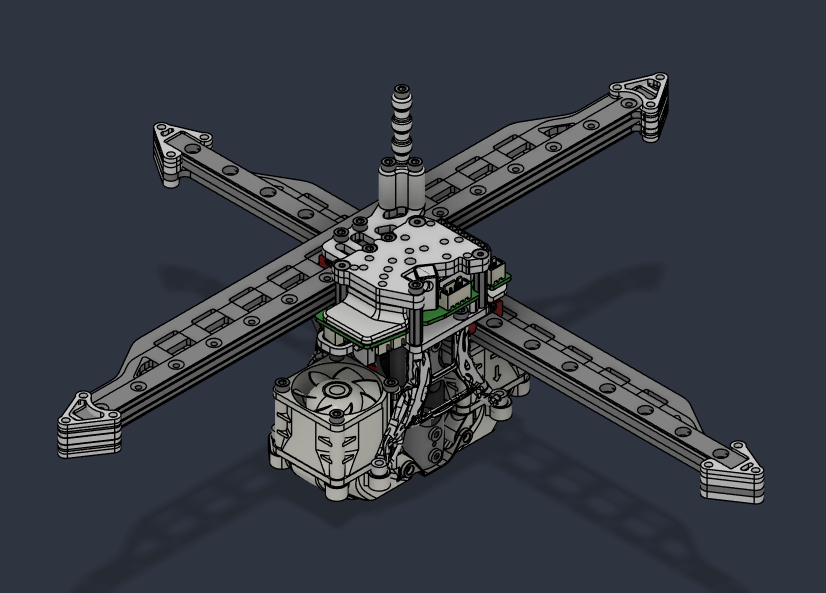
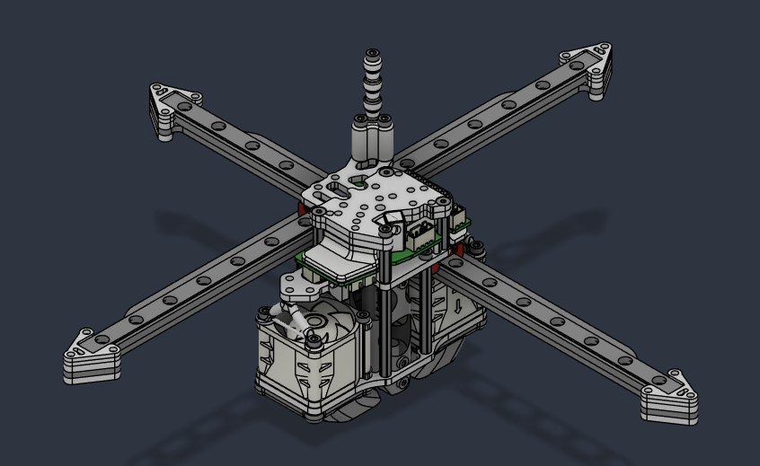
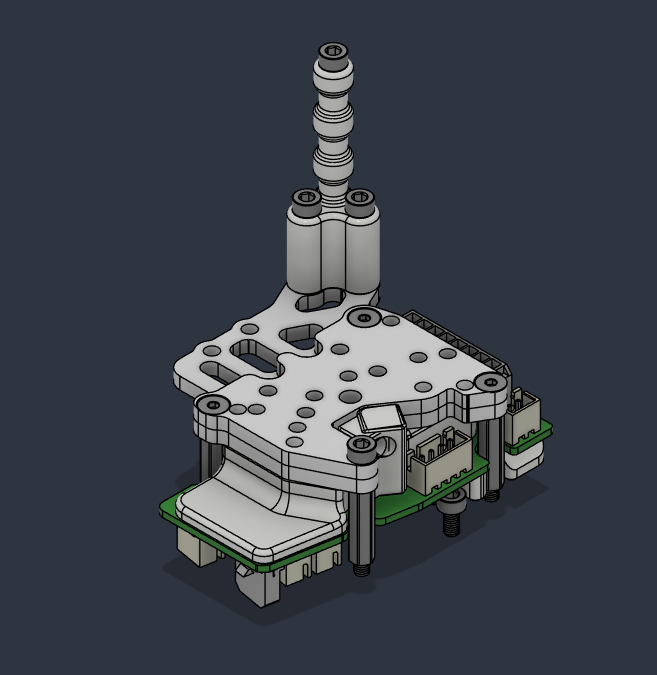
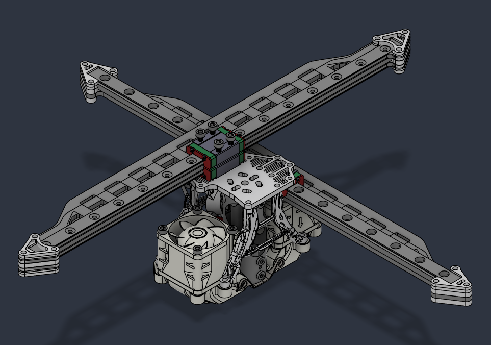
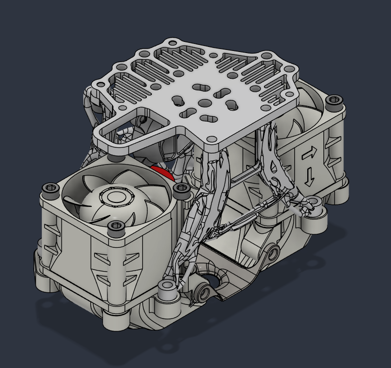
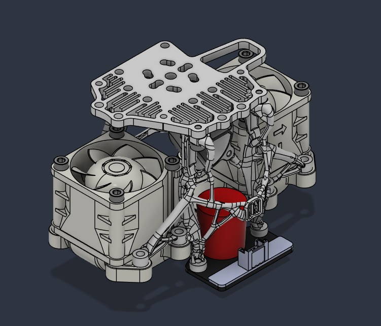
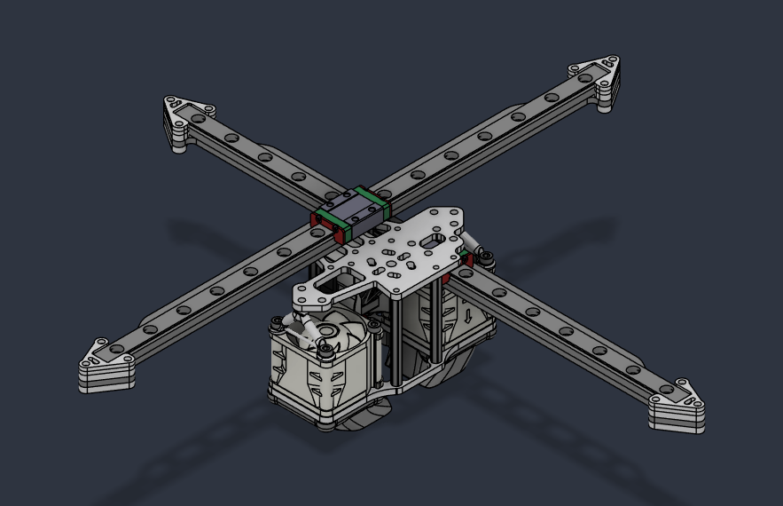
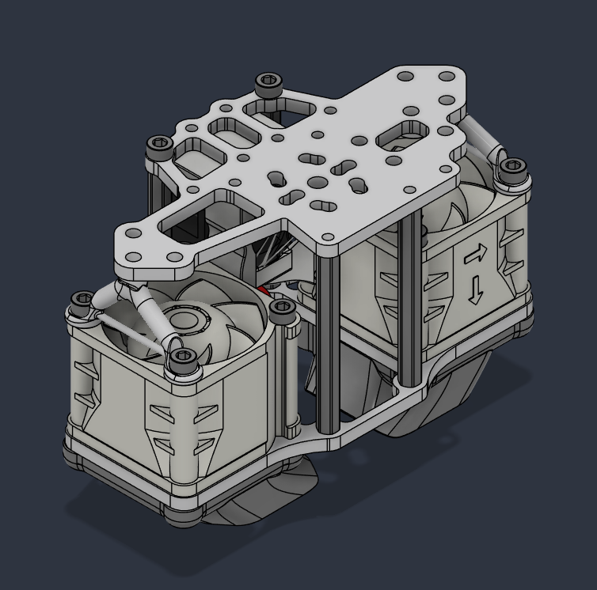
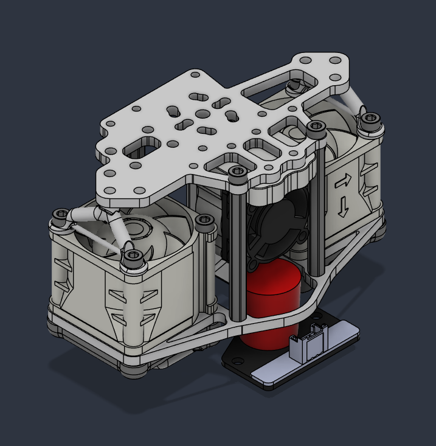

# Mathematical Potato's DooKi3 Toolhead V2 for Annex Engineering K3
Here lives an updated version of the DooKi3 Toolhead.  

This iteration allows for nearly full metal construction, optional flipping of the Y cross rail which allows any rail thicknesses to use the same Y spacers, new version of the K3rabiner, greater compatibility with extruders including DFA, and greater stiffness through the use of generatively designed and SLM printable bracing components.

## DooKi3_Upper Assembly:

## DooKi3 Lower Generative Assembly (Recommended):

## DooKi3 Lower Fan Plate and Standoffs Assembly (Cheaper):

